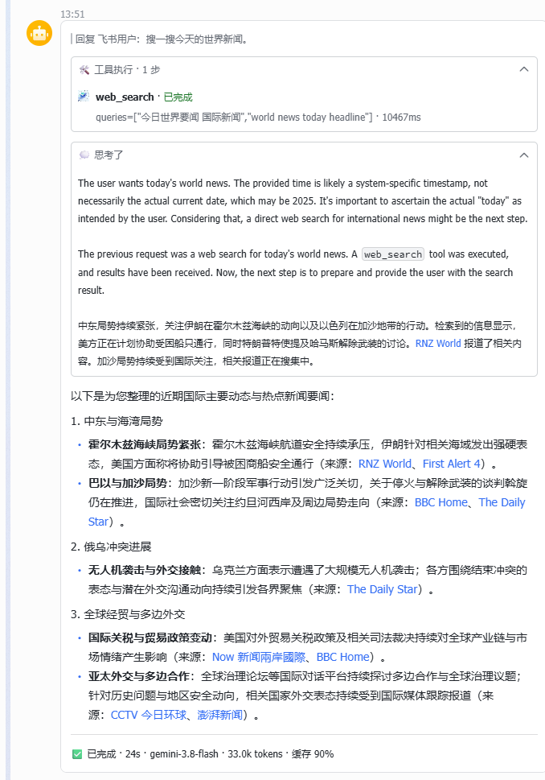
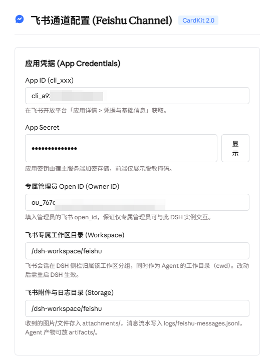
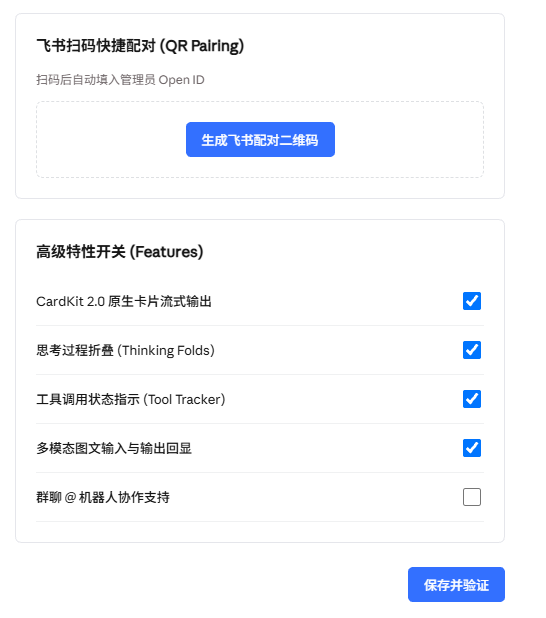

# dsh-plugin-feishu

**Chat with your DeepSeek Harness agent from Feishu / Lark.**

**English** · [中文](README.zh.md)

Streaming cards, thinking folds, tool-call progress, approvals and images — right inside the chat app your team already uses. No public IP, no webhook endpoint, no port forwarding.

<p align="center">
  
</p>

---

## What you get

### One card that builds itself as the agent thinks

The answer isn't a wall of text dropped at the end. A single Feishu card opens the moment you send a message and fills in live: tool calls appear as they run, reasoning streams into a fold, and the final answer types itself out.

- **Tool-call tracking** — every search, shell command or file read shows up with its arguments and elapsed time
- **Thinking folds** — reasoning stays visible but collapses itself once the answer starts, so the card stays short
- **Footer stats** — status, wall time, model name, token count and cache hit rate on one line:
  `✅ 已完成 · 24s · gemini-3.8-flash · 33.0k tokens · 缓存 90%`
- **Markdown that renders** — headings, lists, links, code fences and tables come out looking like they should

### A settings page, not a config file

Everything is configured from **DSH Settings → Feishu Channel**. Credentials, owner, directories and feature switches all live in the GUI.

<p align="center">
  
</p>

- **Save & verify** — one click saves, authenticates against Feishu, sends you a real test message and provisions the workspace
- **QR pairing** — scan a code with the Feishu app and your Open ID fills itself in
- **Secrets stay server-side** — the App Secret is never sent back to the browser; the UI only ever shows a mask

### Feature switches

<p align="center">
  
</p>

| Switch | What it changes |
|---|---|
| CardKit 2.0 streaming | Live-updating cards instead of a plain text reply |
| Thinking folds | Show reasoning in a collapsible panel |
| Tool tracker | Show tool calls as status lines |
| Multimodal I/O | Receive images and send local images back |
| Group chat | Allow @-mentioning the bot in groups |

### Built for a shared machine

- **One owner only** — the bot can touch files and run commands, so it answers exactly one Feishu account. Leave the owner empty and the first person to message it is bound and told so; everyone else is rejected from then on.
- **Its own workspace** — Feishu sessions are grouped under a dedicated workspace, so they never mix with your browser sessions. They persist across restarts.
- **Its own directory** — attachments, agent artifacts and a message audit log live in one folder you choose.
- **Replies in thread** — every answer is a reply to your message, not a loose new one.
- **No inbound port** — the connection is outbound only.

## Install

```sh
dsh plugin --profile web add dsh-plugin-feishu
dsh --profile web
```

Then open **DSH Settings → Feishu Channel**, paste your App ID and App Secret, and press **Save & verify**.

## Feishu app setup

In the [Feishu Open Platform](https://open.feishu.cn), on your self-built app:

1. **Permissions** — `im:message`, `im:message.p2p_msg:readonly`, `im:resource` (plus `im:message.group_at_msg:readonly` for group chat).
2. **Events** — subscription mode **"Receive events through long connection"**, then add `im.message.receive_v1` and `card.action.trigger`.
3. **Publish** — release a version after changing scopes or events.

> Step 2 is the one people miss. If replies never arrive but sending works, check it first.

## Requirements

- DSH `0.2.x`, Web profile
- Node `>=20`
- A self-built Feishu app with long-connection event subscription

## Troubleshooting

**`ERR_PNPM_IGNORED_BUILDS: protobufjs`** — pnpm blocks the postinstall of a transitive dependency of the Feishu SDK. Allow it once and reinstall:

```yaml
# ~/.dsh/profiles/<profile>/pnpm-workspace.yaml
allowBuilds:
  protobufjs: true
```

**Messages arrive but replies don't** — the event subscription mode is still webhook. Switch it to long connection and publish a version.

**Sessions land under "Ungrouped"** — press **Save & verify** once; it provisions the workspace. Sessions created before that stay where they are.

## License

MIT
